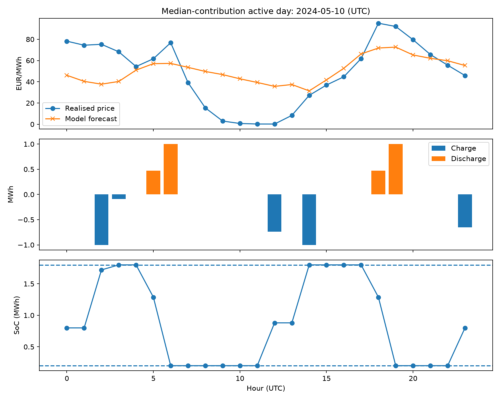
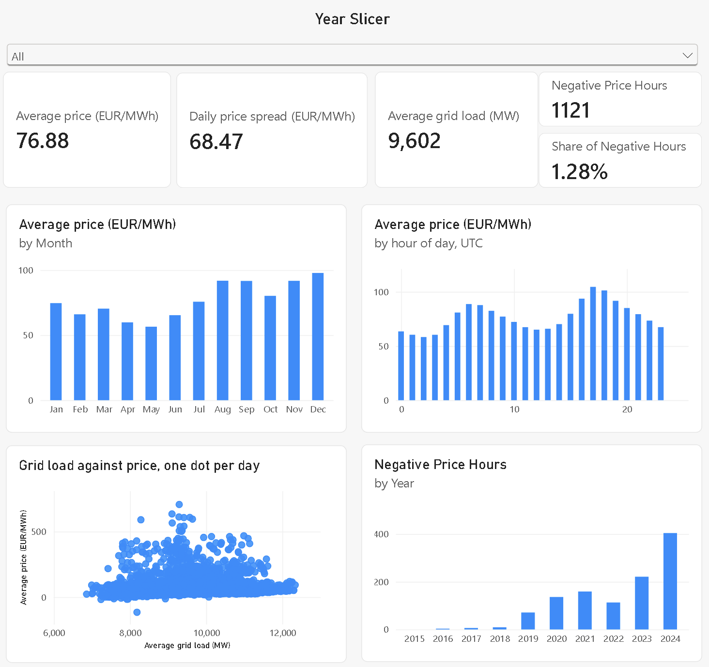

# Belgian Day-Ahead Battery Dispatch Simulation

**Verified result:** In a 2024 out-of-sample historical simulation, a 2 MWh / 1 MW battery scheduled from machine-learning price forecasts achieved a simulated realised contribution of **33,751.14 EUR** after modelled wear, compared with 33,340.01 EUR using a same-hour-yesterday forecast under identical assumptions. A perfect-foresight schedule under the same assumptions would have earned 45,932.84 EUR, so the ML forecast captured about 73.5% of that upper bound and the same-hour-yesterday forecast about 72.6%. The gain from the ML model is small.

## Problem
Electricity storage earns value by shifting energy from low-price to high-price hours, but real decisions must be made before prices are known. This project tests how forecasting, constrained optimisation and fair evaluation fit together.

## Data
Belgian day-ahead hourly prices, 2015-2024: 87,577 hourly records with no missing values or duplicate timestamps after normalisation. Mixed-resolution 2025 data is excluded from the hourly forecast evaluation.

**Price source:** Belgian day-ahead prices (EUR/MWh, bidding zone BE) from the ENTSO-E Transparency Platform (transparency.entsoe.eu), downloaded on 16 Oct 2026 through entsoemcp.com, a site that republishes ENTSO-E data. The price data is not included in this repository: ENTSO-E day-ahead prices are not on its list of data for free re-use. To rebuild it, download the Belgian day-ahead prices for 2015 to 2025 (hourly, with 15-minute prices at the end of 2025) and save them as `data/belgium_day_ahead_2015_2025.csv`.

Source: ENTSO-E Transparency Platform (transparency.entsoe.eu).

**Grid load:** Elia open data, downloaded on 16 Oct 2026 from the Elia open data portal, "Measured and forecasted total load on the Belgian grid (Historical data)", 414,140 quarter-hour rows, 1 Jan 2015 to 23 Oct 2026. The forecast notebooks do not use it yet. The file has blanks for the first 02:00 to 03:00 hour on 31 Oct 2021 (the clock change), so that hour has no load value.

The `data/` folder is not on GitHub (see `.gitignore`), so the notebooks cannot run from a fresh clone until the data files are downloaded and placed there.

## Battery assumptions
Capacity 2 MWh; power 1 MW; SoC 0.2-1.8 MWh; 92% one-way charge and discharge efficiency; 5 EUR/MWh discharge wear allowance; each UTC day starts and ends at 0.8 MWh.

## Method
1. Audit prices and define battery accounting.
2. Build no-action and fixed-rule baselines.
3. Formulate a constrained linear optimiser (perfect-information reference).
4. Split chronologically: train 2015-2022, validate 2023, test 2024.
5. Train a Histogram Gradient Boosting forecast using calendar features, lagged prices and shifted rolling statistics.
6. Schedule each day from forecasts only; settle at realised prices afterwards.
7. Test a conservative forecast-adjustment heuristic on validation only.

## Results
| Method | 2024 MAE | 2024 RMSE |
|---|---:|---:|
| ML forecast | 17.18 EUR/MWh | 23.95 EUR/MWh |
| Same hour yesterday | 23.19 EUR/MWh | 33.24 EUR/MWh |

| Strategy | 2024 realised contribution |
|---|---:|
| No action | 0.00 EUR |
| Same-hour-yesterday forecast dispatch | 33,340.01 EUR |
| ML forecast dispatch | 33,751.14 EUR |
| Perfect foresight (upper bound) | 45,932.84 EUR |

Perfect foresight runs the same daily optimiser with the realised prices as the forecast, so it is an upper bound for these battery assumptions, not an achievable strategy. The ML forecast captured 73.48% of it and the same-hour-yesterday forecast 72.58%, so the ML gain over the simple benchmark is about 0.9 percentage points of that ceiling.

ML dispatch: purchases 51,742.92 EUR, sales 89,939.60 EUR, wear 4,445.54 EUR. All 366 daily solves were optimal; SoC stayed within 0.2-1.8 MWh and terminal SoC matched 0.8 MWh to numerical tolerance.

The uncertainty extension tested adjustments of 0-20 EUR/MWh. Validation selected 0, so the deterministic policy was retained.



## Limitations
- Historical simulation with simplified battery assumptions.
- Excludes trading fees, bid/offer effects, taxes, grid constraints, outages and a realistic degradation model.
- No live asset or market connection.
- Past results do not guarantee future outcomes.
- Deterministic forecast-based optimisation; no stochastic or risk-aware optimiser was built.
- Daily terminal-SoC reset is a simplification.
- The data files are not in the repository, so the results can only be reproduced after downloading the price data from the source above.

## Data pipeline (extract, load, transform)
A small pipeline in `elt/` that rebuilds the clean hourly tables in PostgreSQL. It is a personal project on public data, about 500,000 rows in total, run by hand with no scheduler.

| Step | File | What it does |
|---|---|---|
| Extract | `elt/extract.py` | downloads Elia's total-load data and saves it with the download date |
| Load | `elt/load.py` | copies the raw price and load CSV files into PostgreSQL unchanged (`raw_prices`, `raw_load`) |
| Transform | `elt/transform.sql` | builds `hourly_prices` (same rules as notebook 05), `hourly_load` (15-minute rows averaged to hours) and `hourly_price_and_load` |
| Check | `elt/check.sql` | compares `hourly_prices` with the hourly file the notebooks use: 87,577 rows, same first and last hour, same price total |
| Export | `elt/export_gold.sql` | writes `hourly_price_and_load` to `powerBi/hourly_price_and_load.csv` for the Power BI report |

```bash
createdb battery_dispatch
python elt/extract.py
python elt/load.py
psql -d battery_dispatch -f elt/transform.sql
psql -d battery_dispatch -f elt/check.sql
psql -d battery_dispatch -f elt/export_gold.sql
```
In PyCharm you can instead run `elt/run_pipeline.py`, which does load, transform, check and export in one go (`extract.py` stays separate).
The notebooks still read the CSV files; the pipeline output is checked against them but does not feed the forecast.

### Same pipeline on Databricks
`databricks/battery_pipeline.sql` is a Databricks notebook that does the same steps in SQL on Databricks Free Edition (serverless): bronze tables hold the raw files, silver tables hold the clean hourly prices and load, and a gold table joins them. It ends with the same check against the notebooks' hourly file: 87,577 rows, first hour 2015-01-04 23:00 UTC, last hour 2024-12-31 23:00 UTC, price sum 6,732,582.08, no duplicate hours. All checks pass. To run it, create a volume named `battery_data` in Databricks, upload `belgium_day_ahead_2015_2025.csv` and `elia_total_load_2026-10-16.csv` from `data/` into it, import the notebook and click Run all. It is run by hand, not scheduled.

### Power BI report
`powerBi/` holds a one-page Power BI report on the gold table `hourly_price_and_load` (hourly Belgian day-ahead price and grid load, 2015 to 2024): four key figures, average price by month and by hour of day (UTC), grid load against price (one dot per day) and negative-price hours by year. It uses Import mode, reading the CSV that `elt/export_gold.sql` writes. The measures are explained line by line in `powerBi/DAX_measures.md`. The report file itself is not committed, because it holds a copy of the price data.



Sources: ENTSO-E Transparency Platform (prices), Elia Open Data (grid load).

## Reproduce
```bash
pip install -r requirements.txt
```
Run notebooks `01` to `08` in order with the battery-dispatch kernel. Notebook 06 writes `data/forecast_test_2024.csv`; notebook 07 writes `data/dispatch_test_2024.csv`.
