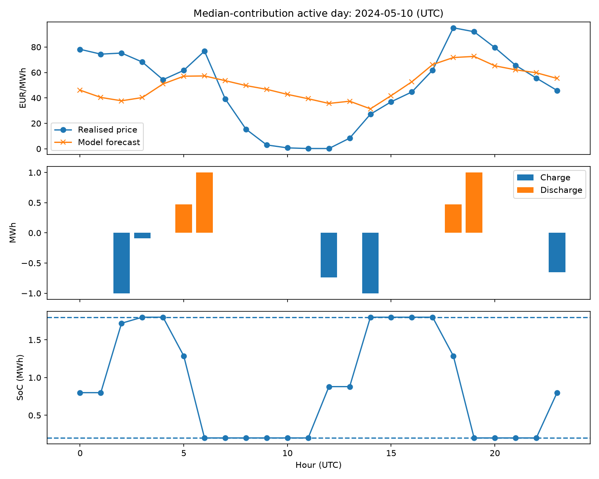

# Belgian Day-Ahead Battery Dispatch Simulation

**Verified result:** In a 2024 out-of-sample historical simulation, a 2 MWh / 1 MW battery scheduled from machine-learning price forecasts achieved a simulated realised contribution of **33,751.14 EUR** after modelled wear, compared with 33,340.01 EUR using a same-hour-yesterday forecast under identical assumptions. A perfect-foresight schedule under the same assumptions would have earned 45,932.84 EUR, so the ML forecast captured about 73.5% of that upper bound.

## Problem
Electricity storage earns value by shifting energy from low-price to high-price hours, but real decisions must be made before prices are known. This project tests how forecasting, constrained optimisation and fair evaluation fit together.

## Data
Belgian day-ahead hourly prices, 2015-2024: 87,577 hourly records with no missing values or duplicate timestamps after normalisation. Mixed-resolution 2025 data is excluded from the hourly forecast evaluation.

## Battery assumptions
Capacity 2 MWh; power 1 MW; SoC 0.2-1.8 MWh; 92% one-way charge and discharge efficiency; 5 EUR/MWh discharge wear allowance; each UTC day starts and ends at 0.8 MWh.

## Method
1. Audit prices and define battery accounting.
2. Build no-action and fixed-rule baselines.
3. Formulate a constrained linear optimiser (perfect-information reference).
4. Split chronologically: train 2015-2022, validate 2023, test 2024.
5. Train a Histogram Gradient Boosting forecast using calendar features, lagged prices and shifted rolling statistics.
6. Schedule each day from forecasts only; settle at realised prices afterwards.
7. Test a conservative forecast-adjustment heuristic on validation only.

## Results
| Method | 2024 MAE | 2024 RMSE |
|---|---:|---:|
| ML forecast | 17.18 EUR/MWh | 23.95 EUR/MWh |
| Same hour yesterday | 23.19 EUR/MWh | 33.24 EUR/MWh |

| Strategy | 2024 realised contribution |
|---|---:|
| No action | 0.00 EUR |
| Same-hour-yesterday forecast dispatch | 33,340.01 EUR |
| ML forecast dispatch | 33,751.14 EUR |
| Perfect foresight (upper bound) | 45,932.84 EUR |

Perfect foresight runs the same daily optimiser with the realised prices as the forecast, so it is an upper bound for these battery assumptions, not an achievable strategy. The ML forecast captured 73.48% of it and the same-hour-yesterday forecast 72.58%, so the ML gain over the simple benchmark is about 0.9 percentage points of that ceiling.

ML dispatch: purchases 51,742.92 EUR, sales 89,939.60 EUR, wear 4,445.54 EUR. All 366 daily solves were optimal; SoC stayed within 0.2-1.8 MWh and terminal SoC matched 0.8 MWh to numerical tolerance.

The uncertainty extension tested adjustments of 0-20 EUR/MWh. Validation selected 0, so the deterministic policy was retained.



## Limitations
- Historical simulation with simplified battery assumptions.
- Excludes trading fees, bid/offer effects, taxes, grid constraints, outages and a realistic degradation model.
- No live asset or market connection.
- Past results do not guarantee future outcomes.
- Deterministic forecast-based optimisation; no stochastic or risk-aware optimiser was built.
- Daily terminal-SoC reset is a simplification.

## Reproduce
```bash
pip install -r requirements.txt
```
Run notebooks `01` to `08` in order with the battery-dispatch kernel. Notebook 06 writes `data/forecast_test_2024.csv`; notebook 07 writes `data/dispatch_test_2024.csv`.
